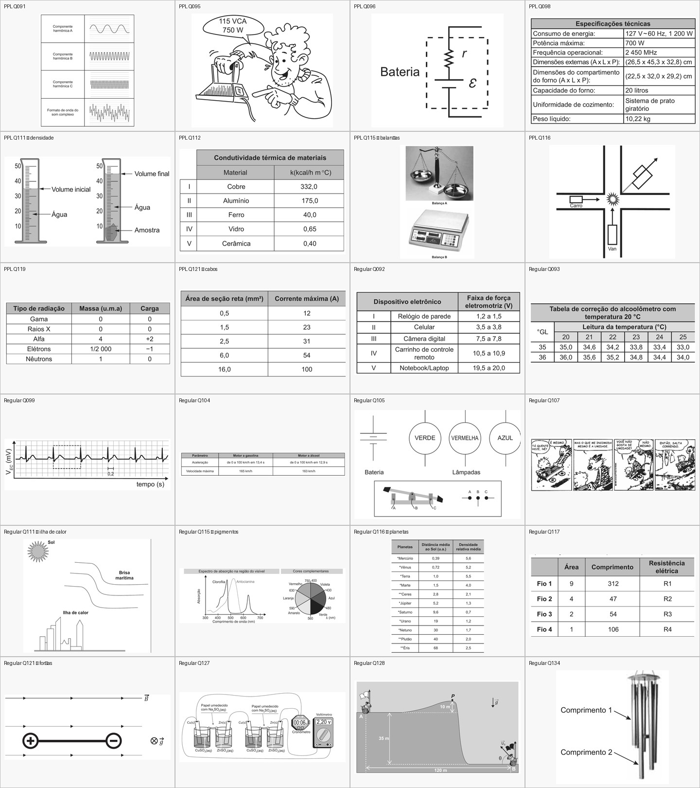
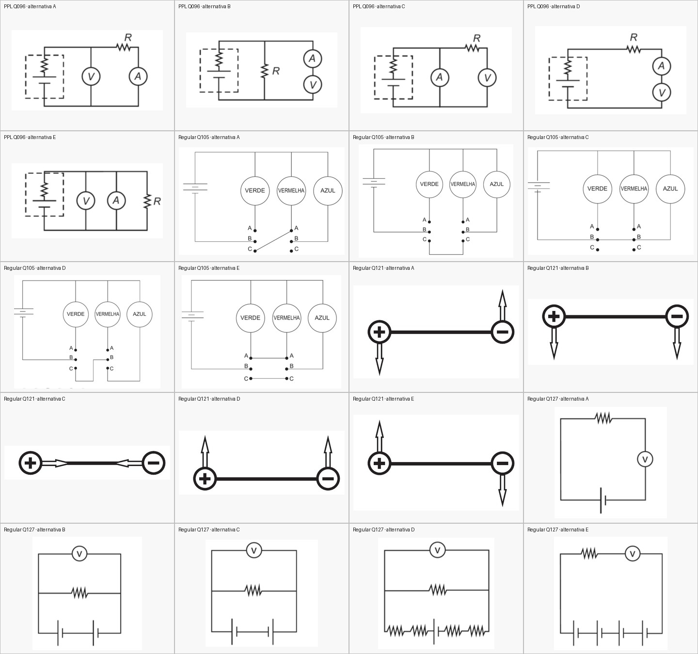

# Imagens das questões ENEM 2021

Este conjunto preenche imagens em **24 questões já cadastradas**: 10 do caderno PPL/Reaplicação e 14 do caderno Regular. São **44 recortes PNG**: uma imagem de referência por questão e cinco diagramas separados nas quatro questões com alternativas ilustradas.

As migrações usam os UUIDs dos registros porque alguns números aparecem nos dois cadernos. Elas preenchem `referencia_imagens_extra[0].url`; nas alternativas ilustradas preenchem `imagem` e limpam somente o texto placeholder iniciado por `[Diagrama`. O texto da questão e as respostas cadastradas são preservados. As imagens ficam em data URI PNG, compatível com o editor e a exportação DOCX do projeto.

## Questões

| Caderno | Questão | UUID | Recorte principal |
| --- | ---: | --- | --- |
| PPL/Reaplicação | 91 | `4a24bbef-8b8f-5d6f-9b0a-eedaf81487d7` | `ppl-q091-reference.png` |
| PPL/Reaplicação | 95 | `77805574-3147-5301-8dbc-86164a1217b3` | `ppl-q095-reference.png` |
| PPL/Reaplicação | 96 | `2c5d4467-05ed-5d1f-969c-c315589f16f1` | `ppl-q096-reference.png` |
| PPL/Reaplicação | 98 | `31b006ff-f02c-51ed-b653-637fa388e996` | `ppl-q098-reference.png` |
| PPL/Reaplicação | 111 — densidade | `d895655f-b3d5-5cab-b9c5-5c2ec01b9973` | `ppl-q111-reference.png` |
| PPL/Reaplicação | 112 | `50b2e8b5-4fba-5076-a0c5-5d6ee2a6481f` | `ppl-q112-reference.png` |
| PPL/Reaplicação | 115 — balanças | `1dafa039-32de-5ccc-9050-cfd38c399e96` | `ppl-q115-reference.png` |
| PPL/Reaplicação | 116 — colisão | `3b74b2b6-c7ff-561e-9da3-1893db6943fb` | `ppl-q116-reference.png` |
| PPL/Reaplicação | 119 | `7c13426c-fb58-5d96-9d46-b164f5f68342` | `ppl-q119-reference.png` |
| PPL/Reaplicação | 121 — cabos | `cc7f9127-9e3b-5c39-a583-5e4456f4aec6` | `ppl-q121-reference.png` |
| Regular | 92 | `86de2624-e921-5de6-a803-b287f88a6219` | `regular-q092-reference.png` |
| Regular | 93 | `d01f81b8-da98-5ff6-bf14-b2746ea71ffe` | `regular-q093-reference.png` |
| Regular | 99 | `aadb2208-dd5f-510c-a9d1-525484739916` | `regular-q099-reference.png` |
| Regular | 104 | `75b01b07-2783-56b0-a876-40e1c43f1937` | `regular-q104-reference.png` |
| Regular | 105 | `91b0d658-8f31-5560-802a-ed9d902f7e2d` | `regular-q105-reference.png` |
| Regular | 107 | `b8af7ccc-8b28-5290-ab20-1c6486a01ed2` | `regular-q107-reference.png` |
| Regular | 111 — ilha de calor | `29ecb386-b751-5f2e-9991-9ac268050a69` | `regular-q111-reference.png` |
| Regular | 115 — pigmentos | `04df2c1e-06ad-5c9f-a21a-0f949b5ba1fd` | `regular-q115-reference.png` |
| Regular | 116 — planetas | `0a2af9d0-9eb1-5ca1-a5a7-155f8dc33931` | `regular-q116-reference.png` |
| Regular | 117 | `18b2c596-3be3-5f1a-881e-5a7576a77bda` | `regular-q117-reference.png` |
| Regular | 121 — forças | `c3acbc8e-6362-5d10-b499-bfaa725f7158` | `regular-q121-reference.png` |
| Regular | 127 | `501e64c5-df36-58c2-8822-9bff4b9feec4` | `regular-q127-reference.png` |
| Regular | 128 | `c87f32cf-b0dc-5379-8867-5b710f7ca9e6` | `regular-q128-reference.png` |
| Regular | 134 | `7d6e574d-6c03-57c0-b5a0-378755d2f0f1` | `regular-q134-reference.png` |

As alternativas ilustradas são PPL/Reaplicação Q96 e Regular Q105, Q121 e Q127. Cada alternativa A–E recebeu seu próprio recorte.

## Conferência visual

### Imagens de referência

### Alternativas

## Aplicação

Aplicar as três migrações em `supabase/migrations/` na ordem pelo nome do arquivo. Cada migração verifica a quantidade de registros atualizados e interrompe caso os registros não correspondam. As atualizações são idempotentes e atingem somente as questões de 2021 da prova ENEM listadas pelos UUIDs.
